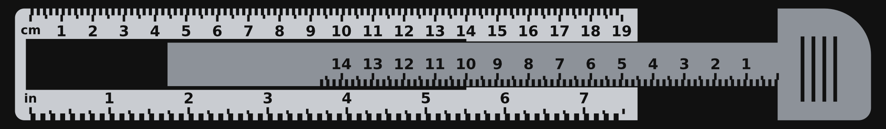
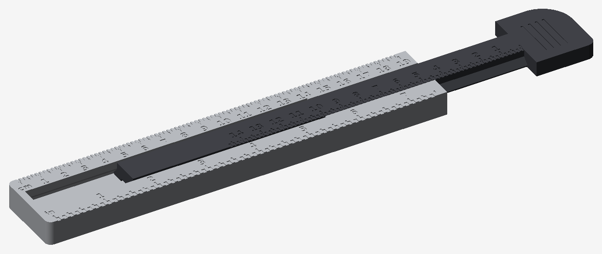

# Sturdy sliding caliper-ruler

An original design in the spirit of the Craighill Metrolog, built to be much
stiffer than the thin Printables version in the parent folder. It is generated
by `generate.py`, so every dimension can be changed and the STL files rebuilt.

## Revision 2 (after the first PLA test print)

The first print bound in the channel, bowed, and the fine scale marks came out
as a rough surface. Changes:

- **Clearances doubled:** 0.4 mm at the sides and 0.5 mm on the dovetail faces
  (was 0.2 and 0.25). The spring tongue still pushes the rail up against the
  dovetail, so the extra clearance does not become wobble.
- **Short guide zone:** only the 55 mm of channel nearest the jaw guides the
  rail. The rest of the channel is 0.8 mm wider per side and 0.4 mm deeper, so
  a slightly bowed body or rail no longer pinches.
- **Printable scales:** every other millimetre (or sixteenth) is a recessed
  band 1 mm (1.6 mm) wide, so each band edge is one unit. Longer 0.8 mm marks
  show 5 and 10 mm, and 1/4, 1/2 and 1 in. Numbers are larger. Nothing is
  narrower than two nozzle widths.
- **Fit-test pieces:** `fit_test_body.stl` and `fit_test_rail.stl` are the top
  of the body and the tail of the rail. Print them first to check the slide,
  the click and the stop before spending filament on the full parts.
- Body and head are 36 mm wide (was 34) to make room for the larger numbers.

## What makes it sturdy

| | Printables version | This design |
| --- | --- | --- |
| Body | 30 × 230 × 5.4 mm | 36 × 200 × 12 mm |
| Material under the channel | thin | 4 mm solid floor |
| Slider | flat strip | 14–20 mm wide, 7.5 mm thick dovetail rail |
| Head and rail | — | one piece, no joint |
| Retention | 1.75 mm filament pin | printed spring tongue and stop in the body |
| Scales | metric only | cm and inch on the body, mm caliper scale on the rail |

- The rail is a 45° dovetail, so it cannot lift out of the body.
- A spring tongue in the body floor pushes a bump into a groove under the
  rail. It gives steady sliding friction and is the end stop.
- At full opening (148 mm) 48 mm of rail is still inside the body.
- The big head corner is a 15 mm radius, usable as a 30 mm circle template.

## Files

| File | Size | Volume |
| --- | --- | --- |
| `sturdy_ruler_body.stl` | 36 × 200 × 12 mm | 56 cm³ |
| `sturdy_ruler_slider.stl` | 36 × 226 × 7.5 mm | 30 cm³ |
| `fit_test_body.stl` | 36 × 62 × 12 mm | 18 cm³ |
| `fit_test_rail.stl` | 20 × 68 × 7.5 mm | 8 cm³ |

## Printing (PLA on an enclosed printer)

- All parts print flat exactly as exported, scale side up. No supports.
- 0.2 mm layers, 0.4 mm nozzle, 3 walls, 15–20 % gyroid infill. Dense infill
  adds shrink stress and makes long parts bow.
- Against bowing: door open and lid off for PLA, bed at 55–60 °C, an 8 mm
  brim, and leave the parts on the bed until it has cooled.
- Against the rough top surface: full part cooling, nozzle at the low end of
  the filament's range, and check the flow calibration if surfaces still look
  overfilled.
- Turn on elephant-foot compensation (about 0.15 mm).
- For readable scales, change filament colour for the last two layers
  (from 11.6 mm on the body and 7.1 mm on the slider), or rub paint or a wax
  crayon into the marks and wipe the surface.

## Assembly

1. Push the rail tail into the open end of the body channel.
2. Keep pushing: the tail rides over the bump and the bump clicks into the
   groove. The slider now stops at 148 mm and cannot pull out.
3. To take it apart, turn the ruler over and pry the tip of the tongue
   (the end nearest the middle of the body) outward with a small
   screwdriver while pulling the slider.

## Use

- Ruler: centimetres on one edge, inches (1/16) on the other.
- Caliper: put the object between the head and the end of the body, then
  read the rail scale where the rail leaves the body.
- Reading the scales: each edge of a recessed band is one unit (1 mm, or
  1/16 in on the inch side).

## Tuning the fit

Edit the parameters at the top of `generate.py` and run it again
(`pip install manifold3d numpy matplotlib`, then `python3 generate.py`).

- Slides too tight: raise `SIDE_GAP` and `TAPER_GAP` by 0.1.
- Slides too loosely: raise `BUMP_TOP` by 0.1–0.2.
- Too much friction: lower `BUMP_TOP` by 0.1–0.2.

## Status

Revision 1 was test printed in PLA and was too tight. Revision 2 has been
checked in software only: all meshes are watertight, the parts do not collide
anywhere along the travel except the intended 0.4 mm spring preload, and the
stop engages at 148 mm. Print the fit-test pieces first.
